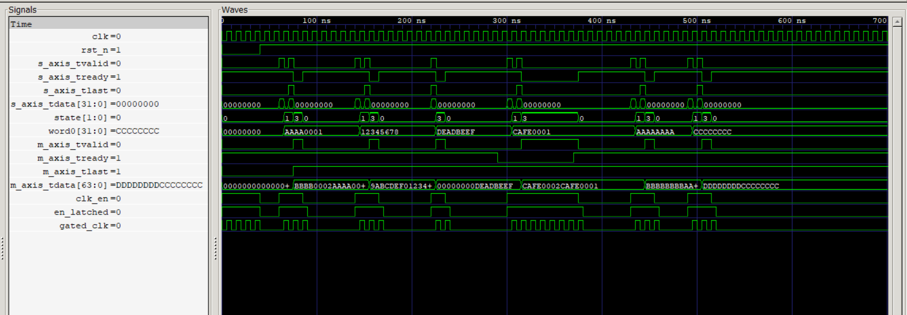

# AXI4-Stream 32-to-64 Bit Width Converter

Verilog RTL that packs two 32-bit AXI4-Stream beats into one 64-bit beat, with a latch-based clock gate for low power and full `tvalid`/`tready` backpressure handling.

## Features
- 2-word packing (first word in lower half, second word in upper half)
- Odd-length packet handling (single word with `tlast`, upper half zero-padded)
- Backpressure: output held stable and input stalled until downstream accepts
- Glitch-free latch-based clock gating; gated clock stops while idle
- Self-checking testbench with pass/fail summary and a watchdog timeout

## FSM
| State | Meaning |
|---|---|
| IDLE  | Waiting for first word |
| FIRST | Holding word 0, waiting for word 1 |
| WAIT  | 64-bit output valid, waiting for `m_axis_tready` |

## Files
| File | Description |
|---|---|
| `axi4s_width_conv.v` | RTL |
| `axi4s_width_conv_tb.v` | Self-checking testbench |
| `axi4s.gtkw` | GTKWave layout |
| `waveform.png` | Simulation waveform |

## Run
```
iverilog -g2012 -o axi4s.vvp axi4s_width_conv.v axi4s_width_conv_tb.v
vvp axi4s.vvp
gtkwave axi4s_conv.vcd axi4s.gtkw
```

## Tests
1. Normal 2-word packet
2. Second 2-word packet
3. Odd-length packet (1 word + `tlast`)
4. Backpressure (output held and input stalled while `m_axis_tready` is low, then released)
5. Back-to-back packets, first packet
6. Back-to-back packets, second packet
7. Clock gating: no gated clock edges while idle

Result: `PASSED: 8  FAILED: 0  RESULT: ALL PASS`

## Waveform


## Tools
Icarus Verilog, GTKWave

## Simulation Log
```
=== AXI4-Stream Width Converter Test ===
32-bit Input to 64-bit Output
=========================================
VCD info: dumpfile axi4s_conv.vcd opened for output.
--- TEST 1: Normal 2-word packet ---
Word 0: 0xAAAA0001
Word 1: 0xBBBB0002 (LAST)
Output:   0xbbbb0002aaaa0001 | LAST=1
Expected: 0xbbbb0002aaaa0001 | LAST=1
TEST 1: PASS

--- TEST 2: Second 2-word packet ---
Word 0: 0x12345678
Word 1: 0x9ABCDEF0 (LAST)
Output:   0x9abcdef012345678 | LAST=1
Expected: 0x9abcdef012345678 | LAST=1
TEST 2: PASS

--- TEST 3: Odd-length packet (1 word) ---
Word 0: 0xDEADBEEF (LAST on first word)
Output:   0x00000000deadbeef | LAST=1
Expected: 0x00000000deadbeef | LAST=1
TEST 3: PASS

--- TEST 4: Backpressure test ---
Downstream NOT ready initially...
Output correctly held, input stalled (backpressure OK)
Releasing downstream ready...
Output:   0xcafe0002cafe0001 | LAST=1
Expected: 0xcafe0002cafe0001 | LAST=1
TEST 4: PASS

--- TEST 5: Back-to-back packets (first packet) ---
Output:   0xbbbbbbbbaaaaaaaa | LAST=1
Expected: 0xbbbbbbbbaaaaaaaa | LAST=1
TEST 5: PASS

--- TEST 6: Back-to-back packets (second packet) ---
Output:   0xddddddddcccccccc | LAST=1
Expected: 0xddddddddcccccccc | LAST=1
TEST 6: PASS

--- TEST 7: Clock gating when idle ---
TEST 7: PASS (gated clock stopped while idle)

=== ALL TESTS COMPLETE ===
PASSED: 8   FAILED: 0
RESULT: ALL PASS
axi4s_width_conv_tb.v:237: $finish called at 795000 (1ps)
```

